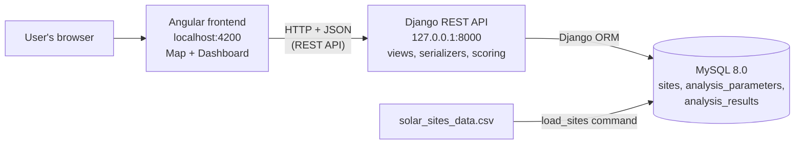

# ☀️ Solar Site Analyzer

A web application that scores 50 potential solar farm sites in Tamil Nadu and shows them on an interactive map and an analytics dashboard.

Each site gets a **suitability score from 0 to 100** based on solar irradiance, land area, distance to the power grid, terrain slope and road access. Users can filter and sort sites, see a full score breakdown for any site, change the weights and recalculate, and export the results as CSV or JSON.

Built for the Datasee.AI Full Stack Developer assessment by **Pavithra Shanmugam**.

Full API documentation with request and response examples: [`docs/API.md`](docs/API.md)

---

## Features

### Core features (all done)

| Requirement | How it is met |
| --- | --- |
| Load the provided dataset | `python manage.py load_sites data/solar_sites_data.csv` loads all 50 sites (safe to run again) |
| Show all sites on an interactive map | Leaflet map with OpenStreetMap tiles, one marker per site |
| Calculate a suitability score | Weighted formula from the brief, in `backend/solar/scoring.py` |
| Filter and sort sites | Minimum score slider, land type filter, 7 sort options (all done by the API) |
| Detailed view of a site | Click a marker or list item: score, category, rank, per-factor breakdown, raw data |
| Responsive UI | Layout stacks on screens under 768 px (map page) and 900 px (dashboard) |

### Map

- Markers coloured by score category: Excellent (80+), Good (60–79), Fair (40–59), Poor (20–39), Very Poor (under 20)
- Tooltip with site name and score on hover
- Legend, and the map zooms to the selected site

### Dashboard

- Summary cards: total sites, average, highest, lowest, standard deviation
- Charts: sites per category, average score by land type, average score of each factor
- Top 10 recommended sites table
- Export filtered results as CSV or JSON

### Bonus features done

- ✅ **Real-time recalculation with adjustable weights**: sliders on the dashboard, live total check, `POST /api/analyze`
- ✅ **Unit tests for critical functions**: 18 tests (scoring formulas, weight validation, all API endpoints, error cases)
- ✅ **Performance**: lazy-loaded pages, one-query aggregates, `select_related`, `bulk_create`, database indexes

---

## Tech stack

| Layer | Technology |
| --- | --- |
| Frontend | Angular 21 (standalone components, signals), TypeScript, HTML5, CSS3 |
| Map | Leaflet 1.9 + OpenStreetMap tiles |
| Charts | Chart.js 4 |
| Backend | Python 3.12, Django 5.2 LTS, Django REST Framework 3 |
| Database | MySQL 8.0 |
| Other | django-cors-headers, PyMySQL, Git + GitHub |

---

## Architecture



**How a request flows (example: the map page)**

1. Angular's `SiteService` calls `GET /api/sites?min_score=70&ordering=-score`.
2. Django's `urls.py` sends it to `SiteListView`.
3. The view gets the latest score for every site from MySQL, applies the filters and sorting, and paginates.
4. `SiteScoreSerializer` turns the rows into JSON.
5. Angular stores the result in a signal; the map and list redraw automatically.

**Backend layers**

| File | Responsibility |
| --- | --- |
| `scoring.py` | Pure maths: factor scores, weighted total, category, weight validation. No database. |
| `services.py` | Database work: run an analysis for all sites, read and save weights, get latest results |
| `serializers.py` | Convert models to JSON and validate input |
| `views.py` | One class per endpoint: read query parameters, call services, return responses |
| `management/commands/` | `load_sites` (import CSV) and `calculate_scores` (score all sites) |

---

## Project structure

```
solar-site-analyzer/
├── README.md
├── docs/
│   └── API.md                      # Full API documentation
├── backend/                        # Django REST API
│   ├── config/                     # Project settings and root URLs
│   ├── solar/                      # The app
│   │   ├── models.py               # Site, AnalysisParameter, AnalysisResult
│   │   ├── scoring.py              # Score formulas (pure functions)
│   │   ├── services.py             # Analysis runs, weights, latest results
│   │   ├── serializers.py          # JSON conversion + input validation
│   │   ├── views.py                # The 5 API endpoints
│   │   ├── urls.py                 # /api/... routes
│   │   ├── tests.py                # 18 unit and API tests
│   │   ├── migrations/             # Database schema (Django migrations)
│   │   └── management/commands/    # load_sites, calculate_scores
│   ├── data/
│   │   ├── solar_sites_data.csv    # Provided dataset (50 sites)
│   │   └── database_schema.sql     # Provided MySQL schema (reference)
│   └── requirements.txt
└── frontend/                       # Angular app
    └── src/app/
        ├── models/site.model.ts    # TypeScript interfaces for the API JSON
        ├── services/site.service.ts# All HTTP calls to the API
        ├── pages/map-page/         # Map, filters, site list, detail card
        ├── pages/dashboard/        # Stats, charts, top 10, weights, export
        ├── score-colors.ts         # Category colours
        └── api.config.ts           # API base URL
```

---

## Setup and run (Linux)

Tested on Ubuntu 24.04 with Python 3.12, MySQL 8.0, Node.js 24 and Angular CLI 21.

### 1. Requirements

```bash
sudo apt update
sudo apt install python3-venv python3-pip mysql-server git -y
# Node.js 20.19+ / 22.12+ / 24 and the Angular CLI
curl -fsSL https://deb.nodesource.com/setup_22.x | sudo -E bash -
sudo apt install nodejs -y
sudo npm install -g @angular/cli
```

### 2. Clone the repository

```bash
git clone https://github.com/pavithrashanmugam1415/solar-site-analyzer.git
cd solar-site-analyzer
```

### 3. Create the MySQL database and user

```bash
sudo mysql
```

```sql
CREATE DATABASE solar_site_analyzer CHARACTER SET utf8mb4;
CREATE USER 'solar_user'@'localhost' IDENTIFIED BY 'choose_a_password';
GRANT ALL PRIVILEGES ON solar_site_analyzer.* TO 'solar_user'@'localhost';
-- Needed only to run the tests (Django creates a temporary test database)
GRANT ALL PRIVILEGES ON test_solar_site_analyzer.* TO 'solar_user'@'localhost';
GRANT CREATE ON *.* TO 'solar_user'@'localhost';
FLUSH PRIVILEGES;
EXIT;
```

### 4. Backend

```bash
cd backend
python3 -m venv venv
source venv/bin/activate
pip install -r requirements.txt

# Database settings are read from environment variables (never stored in code)
export DB_NAME=solar_site_analyzer      # default
export DB_USER=solar_user               # default
export DB_PASSWORD='choose_a_password'
export DB_HOST=localhost                # default
export DB_PORT=3306                     # default

python manage.py migrate                                  # create the tables
python manage.py load_sites data/solar_sites_data.csv     # load 50 sites + default weights
python manage.py calculate_scores                         # score all sites
python manage.py runserver                                # API on http://127.0.0.1:8000/api/
```

Expected output: `Loaded 50 sites` and `Scored 50 sites`.

### 5. Frontend (in a second terminal)

```bash
cd frontend
npm install
ng serve
```

Open **http://localhost:4200**.

> The API allows browser requests only from `http://localhost:4200` and `http://127.0.0.1:4200` (CORS). If you run the frontend on another port, add it to `CORS_ALLOWED_ORIGINS` in `backend/config/settings.py`.

---

## Running the tests

```bash
cd backend
source venv/bin/activate
export DB_PASSWORD='choose_a_password'
python manage.py test solar
```

Result: `Ran 18 tests ... OK`

| Test group | What it checks |
| --- | --- |
| `FactorScoreTests` | Each factor formula against the examples in `Scoring_Calculation_Reference.md` (for example grid 8 km gives 63.16, slope 18° gives 20) |
| `TotalScoreTests` | Site 9 scores 100; custom weights change the total |
| `WeightValidationTests` | Valid weights pass; missing, negative and not-summing-to-1 weights fail |
| `ApiTests` | List sorting and filters, invalid input gives 400, unknown site gives 404, analyze with good and bad weights, statistics, CSV export |

---

## How the score is calculated

```
Total = solar × 0.35 + area × 0.25 + grid × 0.20 + slope × 0.15 + infrastructure × 0.05
```

Each factor is first turned into a score from 0 to 100:

| Factor | 100 points | 0 points | In between |
| --- | --- | --- | --- |
| Solar irradiance | ≥ 5.5 kWh/m²/day | < 3.0 | Straight line |
| Area | ≥ 50,000 m² | < 5,000 m² | Straight line |
| Grid distance | ≤ 1 km | ≥ 20 km | Straight line (closer is better) |
| Slope | ≤ 5° | > 20° | 100 → 50 from 5° to 15°, then 50 → 0 from 15° to 20° |
| Road distance | ≤ 0.5 km | ≥ 5 km | Straight line (closer is better) |

**Worked example: Site 1, Periyanaickenpalayam Site**

| Factor | Value | Score | Weight | Points |
| --- | --- | --- | --- | --- |
| Solar | 5.8 kWh/m²/day | 100.00 | 0.35 | 35.00 |
| Area | 45,000 m² | 88.89 | 0.25 | 22.22 |
| Grid | 2.5 km | 92.11 | 0.20 | 18.42 |
| Slope | 3.2° | 100.00 | 0.15 | 15.00 |
| Road | 0.8 km | 93.33 | 0.05 | 4.67 |
| **Total** | | | | **95.31** |

**Results with the default weights:** average 89.52, highest 100.00, lowest 37.44. 43 sites are Excellent, 3 Good, 2 Fair, 2 Poor, 0 Very Poor.

---

## API summary

Base URL: `http://127.0.0.1:8000/api`

| Method | Endpoint | Purpose | Main parameters |
| --- | --- | --- | --- |
| GET | `/sites` | All sites with latest scores | `min_score`, `max_score`, `land_type`, `ordering`, `limit`, `offset` |
| GET | `/sites/{id}` | One site with full score breakdown and rank | site id in the URL |
| POST | `/analyze` | Recalculate all scores with custom weights | body `{"weights": {...}}`, must sum to 1.0 |
| GET | `/statistics` | Summary numbers, category counts, land type averages, top 10 | none |
| GET | `/export` | Download results | `format` (`csv` or `json`), `min_score`, plus the `/sites` filters |

Request and response examples, error formats and status codes: [`docs/API.md`](docs/API.md)

---

## Design decisions

1. **Scores are calculated in Python, not in the MySQL stored procedure.** The provided `database_schema.sql` includes a stored procedure, but Python code is easier to read, unit-test and run again with custom weights from the API. The same formulas are used, and the tests prove the results match the reference document.
2. **Every analysis run is kept as history.** Each run adds one `AnalysisResult` row per site, with a `parameters_snapshot` of the weights used (as in the provided schema). The API always uses the newest row for each site.
3. **Database tables match the provided schema.** The Django models use the same table names, column names and types (`DECIMAL` for coordinates and measurements), so the data stays exact and compatible with the given SQL.
4. **Filtering, sorting and pagination happen in the API, not the browser.** This keeps the frontend simple and will still work if the dataset grows to thousands of sites.
5. **Clear separation of layers.** Pure scoring logic, database services, serializers and views are in separate files. The Angular side keeps all HTTP calls in one service.
6. **Django 5.2 LTS instead of Django 6.** Django 6 needs MySQL 8.4 or newer. Django 5.2 is a long-term support release that works with MySQL 8.0.
7. **Validation on both sides.** The dashboard disables "Recalculate" until the weights add up to 1.00, and the API validates again (missing keys, values outside 0–1, sum not 1.0), because a client can never be trusted alone.

---

## Assumptions

1. **Site 9 score.** `Scoring_Calculation_Reference.md` shows that the formula gives Site 9 ("Sulur Airbase Adjacent") a score of **100**, but then says the "actual database score" is **87.45**, possibly because of "additional normalization" that is not described. Since that extra step is not defined, I followed the written formula, so Site 9 scores **100.00**. This can be changed easily in `scoring.py` once the normalization rule is known.
2. **Slope scoring.** The main brief says "50: 5–15 degrees", which could mean a flat 50 for that whole range. The reference document and the stored procedure use a straight line from 100 at 5° to 50 at 15°, then down to 0 at 20°. I followed the reference document.
3. **Infrastructure score uses road distance only**, as in the reference document and the stored procedure ("proximity to roads/utilities" has only one column in the data).
4. **Custom weights become the current weights.** `POST /api/analyze` saves the new weights to `analysis_parameters`, so later calls (statistics, export, map) use the latest analysis.
5. Category bands (Excellent, Good, Fair, Poor, Very Poor) come from the "Score Categories" table in the reference document.

---

## Security

- **SQL injection:** all queries use the Django ORM, which escapes every value. No raw SQL. Sorting only accepts fields from a whitelist.
- **XSS:** Angular escapes all values shown with `{{ }}`. No `innerHTML` is used with API data.
- **Input validation:** query parameters are checked (numbers, ranges, allowed values) and return **400** with a clear message; unknown sites return **404**.
- **Secrets:** the database password is read from environment variables and is not in the repository.
- **CORS:** only the Angular app's origins are allowed to call the API from a browser.
- **Database user:** the app uses its own MySQL user with access only to its own database.

---

## Known limitations

- **Development servers only.** `runserver` and `ng serve` are for local use. `DEBUG = True` and the default `SECRET_KEY` from `startproject` must be changed for production.
- **No authentication.** Anyone who can reach the API can run `POST /api/analyze` and change the weights for all users.
- **Distances are given, not calculated.** Grid and road distances come from the CSV; the app does not calculate them from real map data.
- **Analysis history grows.** Each recalculation adds 50 rows to `analysis_results`; there is no clean-up yet.
- **Map tiles need internet** (OpenStreetMap).
- **The site list loads up to 100 sites at once** on the map page; enough for this dataset, but a larger dataset would need paging or marker clustering on the map.

---

## Future improvements

- **Draw a custom area on the map** (Leaflet.draw) and analyse only the sites inside it
- **Compare 2–3 selected sites** side by side
- **Docker:** Dockerfiles for frontend and backend plus `docker-compose.yml` with MySQL
- **CI/CD:** GitHub Actions to run tests and build the frontend on every push
- **Caching** of `/statistics` and `/sites` (Django cache), cleared after each analysis run
- **Authentication** (token or JWT) so only admins can change weights
- **Spatial database features** (MySQL spatial types or PostGIS) to calculate real distances to grid lines and roads
- **Marker clustering** for thousands of sites
- **Frontend unit tests** for the service and components

---

## Author

**Pavithra Shanmugam** · [GitHub](https://github.com/pavithrashanmugam1415)
